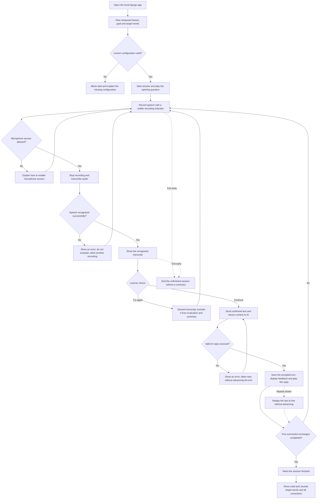

# Speako: Single-Scenario Prototype

## Scope
A local Django application for beginner English restaurant-ordering practice. One configured lesson, five successful learner/AI exchanges, browser speech playback, and a summary built from confirmed turns. No deployment, login, reviewer dashboard, or curator editor in this milestone. Gemini requests are limited to audio transcription and conversational replies/corrections. The summary is assembled locally; no extra summary-generation request is made.

## Flow

## Feedback behavior (US-12)
- A mistake covered by the lesson goals: one sentence explaining it and one corrected example, followed by the conversation reply.
- A correct answer to the current question: continue without adding a correction.
- A grammatically correct but off-topic answer: gently ask a relevant question without labeling the answer incorrect.
- Rejected transcripts never enter the conversation history, summary, or correction list (US-11).

## Requirements review
- US-05: fixed vocabulary and grammar configuration; block an empty vocabulary list. The 90% allowed-vocabulary target still needs measured validation.
- US-09: visible recording and processing states, audio activity feedback, and microphone permission handling. Jingyi approved explicit click-to-record for this prototype; clarify the automatic microphone wording with the team before declaring the full acceptance criterion complete.
- US-10: one lesson card with topic, goal and vocabulary. A complete learning map is deferred.
- US-11 and US-12: the core confirmation and feedback behavior is included.
- US-04: include slower replay; disable it until the first AI line exists.
- US-18: include used/unused words, all corrections, an explicit no-corrections message, and no summary on early exit. Account-based completion and reopening saved summaries are deferred.
- US-06, US-13, US-16, US-17, and US-19: flags/review, account progress, hints/translation, and curator authoring are later milestones.
- US-07 specifies Passing Customs, so the restaurant scenario does not fulfill US-07.
- Five fixed scenarios, account isolation, curator permissions and cross-browser validation remain necessary for the complete MVP.
- Numeric latency and cost pass/fail thresholds are missing from the supplied requirements and must be agreed before judging the planned 50-turn spike. Free-tier access and a five-turn limit are not substitutes for a numerical cost ceiling.

## Implementation and version control
- Project location: C:/Users/Justin/Desktop/SE/speako
- Remote repository: https://github.com/JustinHlink/speako
- Django handles session state and Gemini requests. Keys remain server-side and outside Git.
- The browser handles recording, transcript confirmation and speech playback.
- Summaries use only confirmed learner text and accepted feedback; no additional Gemini summary call.
- Main contains validated versions. Develop features on a feature branch, make focused commits, and tag the verified first prototype v0.1.0.
- Exclude credentials, recordings, databases, virtual environments and temporary outputs from Git.
- Do not claim the entire Requirements MVP is complete after this prototype.

## Agreed measurement plan
The project ceiling is $10 total across development, testing and instructor review. Only transcription and conversational feedback may use Gemini. Use free-tier mode and do not enable billing. Suggested timing tags: page-ready 1.5 s, mic-ready 1 s, recognition 5 s, AI response 5 s, playback start 1 s, local summary 0.5 s, system wait 11 s. Show actual and target next to each relevant step. Record failed attempts and separate learner speaking/review time. Measure the 50-turn spike before accepting these targets as achieved.
